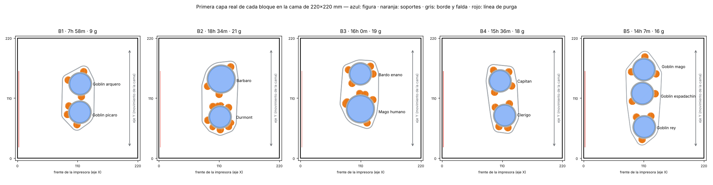

# Impresión por bloques — héroes y goblins ×1,5 (Geeetech A10 Pro, boquilla 0,2 mm)

Las 11 figuras a ×1,5 repartidas en **5 bloques independientes**, cada uno con las figuras **en línea a lo largo del eje Y** (el eje en el que se mueve la cama) y centradas en X = 110 mm. Ningún bloque pasa de 18 h 35 min; el total son unas 72 h de máquina en lugar de una sola tirada de varios días.

## Bloques y orden recomendado

| Orden | Bloque | Figuras | Altura máx. | Tiempo estimado | Filamento |
|---|---|---|---|---|---|
| 1 | `B1_prueba_goblins_picaro_arquero` | Goblin pícaro, Goblin arquero | 40,0 mm | 7 h 58 min | 9,3 g |
| 2 | `B2_Durmont_y_Barbaro` | Durmont, Bárbaro | 61,6 mm | 18 h 34 min | 20,6 g |
| 3 | `B3_Mago_y_Bardo_enano` | Mago humano, Bardo enano | 62,4 mm | 16 h 00 min | 18,8 g |
| 4 | `B4_Clerigo_y_Capitan` | Clérigo, Capitán | 62,6 mm | 15 h 36 min | 18,3 g |
| 5 | `B5_goblins_rey_espadachin_mago` | Goblin rey, Goblin espadachín, Goblin mago | 49,5 mm | 14 h 08 min | 16,1 g |
| | **Total** | 11 figuras | | **≈ 72 h** | **≈ 83 g** |

Cada bloque tiene dos archivos:

- `.gcode`: listo para la tarjeta SD (PrusaSlicer 2.7.2, mismo G-code de inicio y fin que la Hidra: cama 60 °C, boquilla 210/205 °C).
- `.3mf`: proyecto de PrusaSlicer con las figuras ya colocadas y el perfil incrustado, por si quieres mover la columna o cambiar algo y volver a laminar.

`perfil_A10Pro_boquilla0.2_minis_bloques.ini` es el perfil completo, importable en PrusaSlicer (Archivo → Importar → Importar configuración).

## Estrategia

1. **B1 es el bloque de prueba.** Es el más corto y lleva las dos figuras más bajas: valida la adherencia en la franja de la cama, los hilos y los soportes antes de arriesgar una tirada de 15–18 h.
2. **Un bloque por tirada, sin dependencia entre ellos.** El orden de B2 a B5 es indiferente; si prefieres dejar a Durmont para cuando el perfil esté validado dos veces, pasa B2 al final.
3. **Figuras de altura parecida en cada bloque.** Así ninguna se queda imprimiéndose sola en las capas altas (peor refrigeración y tiempo perdido en la ralentización por capa corta).
4. **Entre bloques:** limpiar la cama con alcohol isopropílico y comprobar que la boquilla de 0,2 no arrastra restos; es el fallo más probable en tiradas largas.
5. Si un bloque falla, se pierde como mucho esa tirada, no las 11 figuras.

## Colocación en la cama

- Las figuras van en una sola columna en el sentido de avance de la cama (eje Y). La franja ocupada va de X ≈ 72 a 145 mm y de Y ≈ 24 a 196 mm; el resto de la cama queda libre.
- Si la zona buena de tu cama no es la franja central, abre el `.3mf`, selecciona todo (Ctrl+A), arrastra la columna a izquierda o derecha y vuelve a exportar el G-code. La línea de purga se imprime en X = 2 mm.
- Separación mínima entre figuras (contando soportes): 3–7 mm.

## Qué cambia respecto al perfil anterior

Capa de 0,08 mm y ancho de línea de 0,22 mm se mantienen: el detalle visible no cambia. El tiempo baja por lo que no se ve:

| Ajuste | Antes | Ahora | Motivo |
|---|---|---|---|
| Soportes orgánicos | rama 2 mm, ángulo 40°/25°, separación de puntas 2 mm | rama 1,5 mm, ángulo 60°/45°, separación 4 mm | Los soportes eran el 44 % del tiempo de un goblin; las ramas se funden antes y hay menos retracciones |
| Perímetros | 3 | 2 | Pared de 0,44 mm, suficiente para miniaturas |
| Relleno macizo en zonas pequeñas | < 70 mm² | < 25 mm² | Tobillos, muñecas y armas siguen macizos; torsos y piernas gruesas pasan a relleno giroide del 12 % |
| Velocidad interior | perímetro 30, macizo 35, soporte 40 mm/s | 40, 45 y 50 mm/s | La pared exterior sigue a 20 mm/s |
| Borde (brim) | no | 3 mm | Más agarre en la primera capa |
| Falda | 2 vueltas a 4 mm | 1 vuelta a 3 mm | |

Medido en el Goblin rey solo: 8 h 17 min con el perfil anterior a 0,08 mm (11 h 08 min a 0,06 mm) frente a 5 h 35 min con este (peana rellena incluida).

## Cambios en las mallas

- **Peanas originales rellenadas por debajo.** Durmont y los cinco goblins traían la peana hueca por la cara inferior: solo un aro de 2 mm tocaba la cama (unos 205 mm²). En estos bloques el hueco está relleno, así que apoya el disco completo (unos 1.120 mm²): más adherencia y sin soportes ni puentes dentro de la peana. Los STL de `../stl_individuales` no se han tocado.
- Las figuras están giradas sobre Z para que la columna sea lo más estrecha posible.

## Notas

- Los tiempos son la estimación de PrusaSlicer con los límites de máquina del perfil (aceleración de 500 mm/s²); el tiempo real depende del firmware de la impresora.
- Si hace falta recortar más: capa de 0,10 mm ahorra en torno a un 17 % adicional (medido en el Goblin rey: de 5 h 35 min a 4 h 37 min), a costa de escalones algo más visibles en hombros y cabezas.
- El G-code lleva etiquetas de objeto compatibles con el complemento «Cancel Objects» de OctoPrint.
